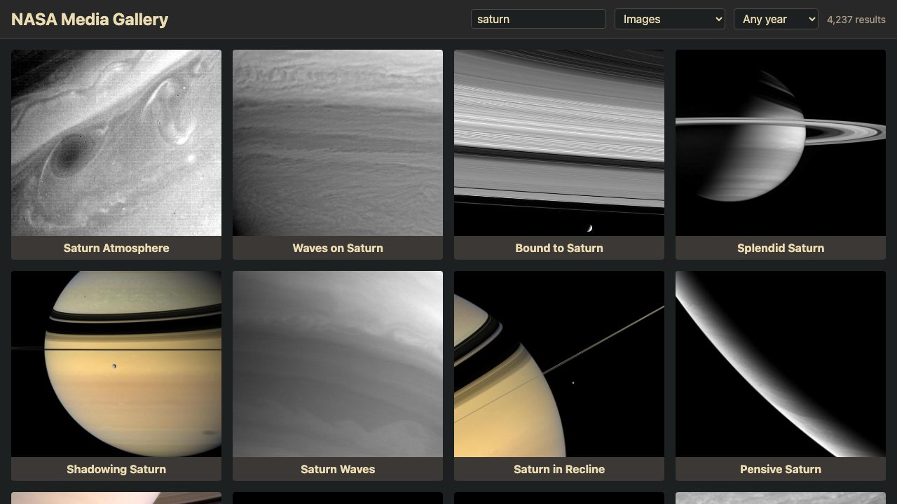

# NASA Media Gallery

Browse NASA's Image and Video Library: search, filter by media type and year, scroll forever, and open any image or video in a viewer you can link to.

**Live:** https://namityadav.github.io/nasa-gallery/



## How it's built

- React 19 and TypeScript, built with Vite. Plain CSS and native form controls, no UI kit. Gruvbox colours, dark or light following the OS.
- **Windowed grid.** Only the rows on screen exist in the DOM (`@tanstack/react-virtual`). Column count, card width and the list's offset are measured with a `ResizeObserver`, not guessed from the window. A resize that changes the column count keeps your place.
- **Paged feed with no races** (`useGallery` in `src/nasa.ts`):
  - A filter change resets the results during render and aborts the request in flight, so stale results never paint.
  - Later pages append and skip repeats. A page that adds nothing new can't stall the feed.
  - The feed stops cleanly at the API's 10,000-result ceiling instead of asking for a page the API refuses.
  - Errors show the API's own reason and a Retry button.
- **Light grid.** Cards load NASA's preview renditions lazily, with a `srcset` so dense screens get the sharper one. The viewer then reads the item's asset list and picks a web-sized file (a larger MP4 on wide screens, the mobile one on phones) instead of the original, which can run to hundreds of megabytes.
- **Shareable state.** Filters live in the query string (`?q=mars&media=video&since=2010`) and the open item in the hash (`#/item/<id>`). Bad or malformed links fall back gracefully.
- **Keyboard and screen readers.** The viewer is a native `<dialog>`, so Esc and Back both close it. However it closes, focus returns to the card that opened it. Focused cards scroll clear of the sticky header, and the result count is announced. Motion respects `prefers-reduced-motion`.
- **Checks.** ESLint (`react-hooks`, `jsx-a11y`), TypeScript strict mode and Vitest run on every push before the GitHub Pages deploy. Tests cover the feed logic and the viewer's behaviour: focus return, a link to a missing item followed by a good one, malformed links, and filters round-tripping through the URL.

Known gap: NASA serves its caption files without CORS headers, and mostly as `.srt`, which browsers can't play, so videos play without captions.

Data: [NASA Image and Video Library API](https://images.nasa.gov/). No key needed.

## Run it

```bash
npm install
npm run dev
npm run lint
npm test
```

## History

Started in 2020 as an Imgur gallery viewer on Create React App and Material UI. Rebuilt in 2026 on NASA's open API.
